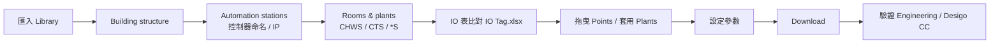

# ABTsite Library

> 標準化設計及通用資料庫紀錄 — 提供非客製化案場快速應用之模板，或作為外包提供資料之標準。

| 項目 | 內容 |
|---|---|
| 程式名稱 | 冰機系統相關模塊（ABT site Library） |
| 版本 | v1.1.3 |
| 維護者 | Phill.Lin / SI B |
| 文件更新日期 | 2026-10-21 |
| 適用對象 | 系統工程師 |
| 執行方式 | Import 進 ABTsite Library |
| 已測試環境 | ABTsite v5.2 以上 |
| 使用範圍 | 西門子 SI B 內部人士使用（不得外流） |

---

## 目錄

- [用途與適用範圍](#用途與適用範圍)
- [主要功能](#主要功能)
- [文件導覽](#文件導覽)
- [執行環境](#執行環境)
- [使用前準備](#使用前準備)
- [安裝與設定](#安裝與設定)
- [快速開始](#快速開始)
- [建置流程總覽](#建置流程總覽)
- [常見問題與故障排除](#常見問題與故障排除)
- [已知限制](#已知限制)
- [專案結構](#專案結構)
- [版本紀錄](#版本紀錄)
- [維護與問題回報](#維護與問題回報)
- [授權與使用限制](#授權與使用限制)

---

## 用途與適用範圍

本 Library 用於非客製化案場的快速建置，協助系統工程師以標準化點位、模塊與系統模板，快速完成案場冰機系統程式。

適用範圍

- 6 台冰機（含）以內之冰水系統
- 4 台冷卻水塔（含）以內之冷卻系統
- 製作 layout（Building structure / Automation stations / Rooms & plants）
- 查找標準點位名稱（IO Tag）
- 確認資料生成路徑（Desigo CC 依 Rooms & plants 路徑建立）

不適用範圍

- DXR 系列控制器
- 空調箱系統（AHU）
- 能源運算

## 主要功能

| 功能 | 說明 |
|---|---|
| Points | 各類點位（AI、AO、AV、DI、DO）標準資料庫，常用點位可直接拖曳使用 |
| Blocks | 通用程式模塊，用於子運算（冰機系統、前置條件、水塔系統、特殊條件） |
| Modbus | 常用通訊 mapping 點位（BELIMO 閥體、Chiller、Flow meter、LINE、Power Meter、Vertive、VFD） |
| Plants | 冰水系統（CHWS）、冷卻系統（CTS）程式生成模板 |
| 建置規則 | 控制器命名、Building structure、Plant & Room 命名規則 |

## 文件導覽

| 文件 | 內容 |
|---|---|
| [docs/Guide.md](docs/Guide.md) | 完整使用手冊（安裝、建置規則、操作步驟、驗證、維運） |
| [docs/Building-Rules.md](docs/Building-Rules.md) | 建置規則：Building structure、Controller Name Rule、Plant & Room setting |
| [docs/Point-Tag-Reference.md](docs/Point-Tag-Reference.md) | Library 內容：Points 點位代碼表、Blocks、Modbus device |
| [docs/CFC-Chilled-Water-System.md](docs/CFC-Chilled-Water-System.md) | 冰水系統 CHSYS CFC 模塊說明與接線表 |
| [docs/CFC-Cooling-Tower-System.md](docs/CFC-Cooling-Tower-System.md) | 冷卻系統 CTSYS CFC 模塊說明與接線表 |
| [docs/Sample-Site.md](docs/Sample-Site.md) | 範例案場：XXX 科技廠 N 場 |
| [docs/Flowcharts.md](docs/Flowcharts.md) | 所有流程圖（Mermaid 原始碼與圖檔） |
| [docs/Pre-Download-Checklist.md](docs/Pre-Download-Checklist.md) | 下載至控制器前檢查表 |
| [CHANGELOG.md](CHANGELOG.md) | 版本紀錄 |

## 執行環境

| 項目 | 要求 |
|---|---|
| 作業系統 | Windows、Linux |
| 執行環境 | ABTsite v5.2 以上 |
| 其他條件 | 已匯入 ABTsite Library |
| 外部資料 | IO Tag.xlsx、Units Name Tag.xlsx（雲端）、案場 IP 設定表 |

## 使用前準備

- [ ] 已取得完整程式檔案（`ABT site Library.s1cx`、`Sample.ABTArchive`）。
- [ ] 電腦符合執行環境要求。
- [ ] 已確認可匯入的資料庫。
- [ ] 已確認輸出資料夾具有寫入權限。
- [ ] 若會修改、移動或覆蓋檔案，已先備份原始資料。
- [ ] 已取得案場 IP 設定表（控制器名稱、IP、Mask、Gateway、Instance）。
- [ ] 已取得案場 IO 表（需求點位）。

## 安裝與設定

步驟 1：取得程式

取得附件 `ABT site Library.s1cx`。

步驟 2：匯入 Library

於 ABTsite 開啟 Library，執行 Import，選擇 `ABT site Library.s1cx`。

> 部分資料需在 Programming 的 Library 才可拉入使用。

步驟 3：確認安裝成功

確認 Library 出現 `ABT site Library` 資料夾，內含以下四個子資料夾：

```
ABT site Library/
├── Blocks/          # 冰機系統、前置條件、水塔系統、特殊條件
├── Modbus device/   # BELIMO閥體、Chiller、Flow meter、LINE、Power Meter、Vertive、VFD
├── Plants/          # 冰水系統、冷卻系統模板
└── Points/          # AI、AO、AV、DI、DO
```

## 快速開始

以下流程使用隨附範例資料，不修改正式資料。

1. 將 `Sample.ABTArchive` 以 Restore project 復原至 Projects。
2. 開啟專案。
3. 以 Administrator 帳號登入（密碼請向維護者索取，不寫入版本庫）。
4. 對照 [docs/Sample-Site.md](docs/Sample-Site.md) 及 `Sample.pdf` 範例情境操作。

## 建置流程總覽



完整流程圖請見 [docs/Flowcharts.md](docs/Flowcharts.md)。


## 常見問題與故障排除

| 問題／錯誤訊息 | 可能原因 | 處理方式 |
|---|---|---|
| 需求 IO 不在 Library | 未建置 | 確認雲端 IO Tag.xlsx 內是否有相關定義；若沒有，請協同維護者新增並定義該點位 |
| 實際程式需求與模板不符 | 非常態系統 | 自行撰寫 CFC，或以 Blocks 模塊自行拼組（兩者皆需一定熟悉度） |
| Library 拉不進某些資料 | 資料位於 Programming 的 Library | 改由 Programming 的 Library 拖曳 |
| Desigo CC 畫面沒有對應數值 | Rooms & plants 路徑或 reference 未對應 | 檢查 Plant 路徑與 CC reference |
| Engineering 無法 connect | 控制器網路設定錯誤 | 核對 IP / Mask / Gateway / Instance 與 IP 設定表 |
| 冰機超過 6 台 / 水塔超過 4 台 | 超出模板上限 | 自行撰寫 CFC |

詳細排除流程請見 [Guide 第 10 章](docs/Guide.md#10-常見問題與故障排除)。

## 已知限制

- 數量上限：冰機 6 台、冷卻水塔 4 台。
- 尚未支援：空調箱系統、DXR 系列、能源運算。
- 程式下載後不會顯示運轉週期；執行時間跟隨控制器壽命。
- 不應調整 CFC 內部邏輯；如需調整請與維護者確認。

## 專案結構

```
ABTsite-Library/
├── README.md                         # 專案與使用說明（本文件）
├── CHANGELOG.md                      # 版本紀錄
├── docs/
│   ├── Guide.md                      # 完整使用手冊
│   ├── Building-Rules.md             # 建置與命名規則
│   ├── Point-Tag-Reference.md        # 點位代碼 / Blocks / Modbus 參考
│   ├── CFC-Chilled-Water-System.md   # 冰水系統 CFC 說明
│   ├── CFC-Cooling-Tower-System.md   # 冷卻系統 CFC 說明
│   ├── Sample-Site.md                # 範例案場
│   ├── Flowcharts.md                 # 流程圖總覽
│   ├── Pre-Download-Checklist.md     # 下載前檢查表
│   └── reference/                    # 原始參考檔（CHSYS.pdf、CTSYS.pdf、README 原稿）
├── flowcharts/                       # Mermaid 原始碼 (.mmd) 與 SVG / PNG
└── assets/                           # 截圖（Library、Notion 範例）
```

交付套件（不進版本庫，另行提供）：

```
project/
├── ABT site Library.s1cx   # 套件資料庫
├── Sample.ABTArchive       # 參考用專案
├── Sample.pdf              # 參考用專案情境
└── Guide.pdf               # 使用手冊（可由 docs/Guide.md 轉出）
```

## 版本紀錄

| 版本 | 日期 | 變更內容 |
|---|---|---|
| v1.0.0 | 2026-09-21 | 初始版本 |
| v1.1.0 | 2026-10-03 | 功能模組修復 |
| v1.1.1 | 2026-10-04 | 常用點位補充 |
| v1.1.2 | 待補 | 待維護者補充 |
| v1.1.3 | 2026-10-12 | 待維護者補充（文件標示之現行版本） |

完整內容見 [CHANGELOG.md](CHANGELOG.md)。

## 維護與問題回報

- 維護者：Phill.Lin / SI B
- 聯絡方式：Phill.lin@siemens.com
- 問題回報：Email
- 維護狀態：持續維護

## 授權與使用限制

- 使用範圍：西門子 SI B 內部人士使用。
- 修改與再散布：須確保不外流。
- 第三方元件與授權：如適用。

## 相關文件

- 使用者操作手冊：[docs/Guide.md](docs/Guide.md)
- 設定說明：[docs/Building-Rules.md](docs/Building-Rules.md)
- 範例資料：[docs/Sample-Site.md](docs/Sample-Site.md)
- 雲端資料庫：IO Tag.xlsx、Units Name Tag.xlsx（連結見 [Building-Rules](docs/Building-Rules.md#外部資料庫)）
