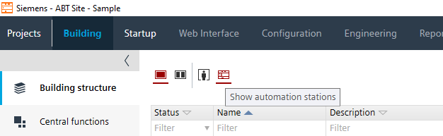
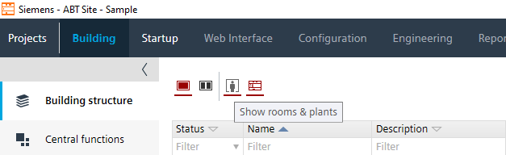

# ABT Site 建置規則

本文件整理 ABTsite 專案的資料階層、控制器命名、Plant / Room 命名規則。所有欄位值以「案場 IP 設定表」為唯一來源。

來源：Notion「ABT Site 建置規則及範例」及其子頁 ABT Site Building structure、Controller Name Rule、Controller plant & room setting。

---

## 1. Building structure

ABTsite → Building → Building structure 有兩種檢視，兩者共用同一套 Building / Floor 階層：

| 檢視 | 按鈕 | key | 資料階層下的物件 | 用途 |
|---|---|---|---|---|
| Show automation stations |  | 控制器位置 | Controller、DXR 等控制器設備 | 定義控制器實體安裝位置 |
| Show rooms & plants |  | 供應或應用的區域 | Rooms、Plants 等虛擬範圍 | Desigo CC 依此路徑建立 |

> Desigo CC 的物件路徑是根據 Rooms & plants 的階層建立，因此 Plant 的位置與命名會直接影響 CC 畫面與 reference。

### 1.1 Building elements 命名

| building elements | Building | Floor | Area | Subarea | Section |
|---|---|---|---|---|---|
| Name | 自訂義或案場代碼 | 樓層代碼 | `Ar` + 流水號 | `sbAr` + 流水號 | `sc` + 流水號 |
| Description | 樓宇名稱 | 樓層代碼 | 區域，例：走道、病房區、醫療區 | 子區域 | 部門 |

樓層代碼建議格式：`B1`、`01F`、`02F`、`03F`（屋頂層可在 Description 標示 `RF`）。

### 1.2 Bacnet / IP ranges（視情況設定）

| 群組 | 欄位 | 設定來源 |
|---|---|---|
| Bacnet ranges | start of name index | IP 設定表 instance |
| Bacnet ranges | name index end | IP 設定表 instance |
| IP ranges | Start host name index | IP 設定表 instance |
| IP ranges | End host name index | IP 設定表 instance |
| IP ranges | IP address start | IP 設定表 IP |
| IP ranges | IP address end | IP 設定表 IP |
| IP ranges | subnet mask | IP 設定表 IP |
| IP ranges | default gateway | IP 設定表 IP |

---

## 2. Controller Name Rule

| 分類 | 欄位 | 設定規則 |
|---|---|---|
| Naming | Name | 依 IP 設定表「控制器名稱」 |
| Naming | Description | `供應區域-XX系統` 或案場設備編號 |
| Naming | Equipment ID | 依 IP 設定表 instance |
| Bacnet | Object name | 依 IP 設定表 |
| Bacnet | Device instance number | 依 IP 設定表 instance |
| IPv4 | Host name | 依 IP 設定表 instance |
| IPv4 | IP address | 依 IP 設定表 IP |
| IPv4 | Subnet mask | 依 IP 設定表 mask |
| IPv4 | Default gateway | 依 IP 設定表 default gateway |

控制器名稱格式（依範例歸納）：

```
<案場代碼>-<樓層代碼>-<流水號3碼>
例：N-B1F-001、N-01F-002、N-03F-001
```

---

## 3. Controller plant & room setting

### 3.1 Plant

| Function | Name | Description EN | Description CH | 備註 |
|---|---|---|---|---|
| chiller system（chiller、pump） | CWS | Chilled Water System | 冰水系統 | 範例案場使用 `CHWS` |
| chiller system（heater、pump） | HWS | Heating Water System | 熱水系統 | |
| chiller system（heater、pump、hex） | BS | Brine System | 滷水系統 | |
| cooling tower system（cooling tower） | CTS | Cooling Tower System | 冷卻系統 | |
| unit system（只有一種設備，例：hex、zone pump） | `*S` | `*` Unit System | `*`系統 | `*` 依 Units Name Tag 定義，例：ZPS 區域泵系統、AHS 空調系統 |

規則：

- 同系統但不同控制器，以 extension 切分，例：`ZPS(N)`、`ZPS(S)`。
- `*S` 的 `*` 代碼請查 Units Name Tag.xlsx。

> 注意：規則表的冰水系統代碼為 `CWS`，範例案場使用 `CHWS`。建議案場統一採用其中一種並於 Units Name Tag.xlsx 註記，避免與冷卻水（Condenser Water）縮寫混淆。

### 3.2 Room / Segment

Notion 規則頁目前保留 Room 與 Segment 標題，尚未定義內容（待補）。

---

## 4. Plant 內部點位階層

依範例 Engineering → Plants 畫面，Plant 下以「設備 → 側別 → 驅動方式 → 點位」組織：

```
區域泵系統 (ZPS)
├── 入水側/
│   └── [AI] 溫度
├── 區域泵01/
│   ├── 出水側/
│   │   └── [AI] 溫度
│   ├── 直接/            # 定頻
│   │   ├── [BI] 狀態
│   │   ├── [BI] 跳脫
│   │   └── [BO] 起停
│   ├── 變頻/
│   │   ├── [AI] 回授
│   │   ├── [BI] 狀態
│   │   ├── [BI] 跳脫
│   │   ├── [AO] 控制
│   │   └── [BO] 起停
│   ├── [BI] 手自動
│   └── [BI] 模式
└── 區域泵02/ ...
```

點位命名格式：`[BACnet 物件類型] 中文功能`。Library 的 DI / DO 於 BACnet 中對應 BI / BO。

---

## 外部資料庫

| 檔案 | 用途 | 連結 |
|---|---|---|
| IO Tag.xlsx | 標準點位代碼與定義 | [IO Tag.xlsx](https://1drv.ms/x/c/a26236f3247facec/IQD58ioHAmiNRp7MTH14Ym8bAVooEdthnYb2jcivli8UmnY?e=0imCkZ) |
| Units Name Tag.xlsx | 設備 / 系統代碼（`*S` 的 `*`） | [Units Name Tag.xlsx](https://1drv.ms/x/c/a26236f3247facec/IQBsOKZ_NfbbRaJ0zZoLh6pEAetL_lLOy7QPhdQO6UGG5Js?e=Bjwby0) |
| IP 設定表 | 控制器名稱、IP、Mask、Gateway、Instance | 依案場提供 |
