# 冷卻系統 CFC（CTSYS）

來源：`docs/reference/CTSYS.pdf`（TIA Portal 匯出，冷卻系統 - Partition_1，Task：OB1，共 3 頁）。

> 標記說明：接線依 CFC 圖面判讀；標示【推定】者為依腳位名稱推論，請以 Library 實際模塊為準。

---

## 1. 架構總覽

```
OB1 / Partition_1
├── 1.1  水塔頻率計算 → CT1~CT4 變頻驅動控制 (CMD_A)
│        Interconnection：CTs.con.出水溫、CTs.con.水塔系統…
└── 2.1  水塔加減機 → CT1~CT4 變頻驅動起停 (CMD_B)、水塔系統狀態
         水塔跳脫判別 → CT s 跳脫狀態
```

模板最多支援 4 台冷卻水塔（CT1~CT4）。


---

## 2. 水塔頻率計算（CFC）

| 腳位 | 方向 | 接線來源 / 去向 | 型別 |
|---|---|---|---|
| 水塔系統起停 | 輸入 | 水塔系統起停點 | CMD_B |
| 乾球溫度 | 輸入 | 外氣乾球溫度計 | R_A |
| 相對濕度 | 輸入 | 外氣相對濕度計 | R_A |
| 趨近溫度SET | 輸入 | 趨近溫度設定 | W_A |
| 出水溫 | 輸入 | 冷卻水總出水溫度計 | R_A |
| 輸出高限 | 輸入 | 輸出高限 | W_A |
| 輸出低限 | 輸入 | 輸出低限 | W_A |
| 正反向 | 輸入 | CTR 正反向 | W_B |
| 頻率 | 輸出 | → CT1~CT4 變頻驅動控制 `ValIn1`（Prio 16） | — |

功能說明【推定】：

- 由乾球溫度與相對濕度計算外氣濕球溫度 Twb。
- 目標出水溫 = Twb + 趨近溫度 SET。
- 比較冷卻水出水溫與目標值，依正反向設定調節頻率，並限制於輸出低限～高限。

### CT1~CT4 變頻驅動控制（CMD_A）

| 腳位 | 設定 |
|---|---|
| EnIn1 | 1 |
| ValIn1 | 水塔頻率計算.頻率 |
| PrioIn1 | 16: Prio 16 |
| EnIn2 / ValIn2 / PrioIn2 | 0 / 0.0 Hz / 17: Inactive |
| EnIn4 / ValIn4 / PrioIn4 | 0 / 0.0 Hz / 17: Inactive |
| TshVal | 0.1 Hz |

---

## 3. 水塔加減機（CFC）

| 腳位 | 方向 | 接線來源 / 去向 | 型別 |
|---|---|---|---|
| 水塔系統起停 | 輸入 | `…/cmd_b_1.PrVal`（水塔系統起停點） | — |
| 出水溫 | 輸入 | `…/TM.PrVal`（冷卻水總出水溫度計） | — |
| 加機溫度 | 輸入 | 加機溫度（預設 0.0，TshVal 0.1） | W_A |
| 減機溫度 | 輸入 | 減機溫度（預設 0.0，TshVal 0.1） | W_A |
| 使用台數 | 輸入 | 可運轉系統數量 | W_DINT |
| 加機間隔 | 輸入 | 加機間隔 | W_DINT |
| 減機間隔 | 輸入 | 減機間隔 | W_DINT |
| CT1狀態 ~ CT4狀態 | 輸入 | CT1~CT4 變頻驅動狀態 | R_B |
| CT狀態 | 輸出 | → 水塔系統狀態（W_B） | — |
| CT1 起停 ~ CT4 起停 | 輸出 | → CT1~CT4 變頻驅動起停 `ValIn1`（Prio 16） | — |

功能說明【推定】：依冷卻水出水溫與加 / 減機溫度、間隔決定運轉台數；運轉台數不超過使用台數；CT 狀態回饋用於判斷可用水塔。

### CT1~CT4 變頻驅動起停（CMD_B）

| 腳位 | 設定 |
|---|---|
| EnIn1 | 1 |
| ValIn1 | 水塔加減機.CTn 起停 |
| PrioIn1 | 16: Prio 16 |
| EnIn2 / ValIn2 / PrioIn2 | 0 / 0 / 17: Inactive |
| EnIn4 / ValIn4 / PrioIn4 | 0 / 0 / 17: Inactive |

---

## 4. 水塔跳脫判別（CFC）

| 腳位 | 方向 | 接線 |
|---|---|---|
| CT1OL ~ CT4 OL | 輸入 | CT1~CT4 變頻驅動跳脫（R_B） |
| CT 跳脫狀態 | 輸出 | → CT s 跳脫狀態（W_B） |

---

## 5. 與冰水系統的連動

| 冷卻系統輸出 | 冰水系統輸入 | 說明 |
|---|---|---|
| 水塔系統狀態 | `水塔狀態.PrVal` → 各系統 `Prt.Cnf_n.水塔狀態` | 保護機制確認水塔運轉 |
| CT s 跳脫狀態 | `水塔OL.PrVal` → 各系統 `OL.Cnf_n.水塔OL` | 水塔跳脫時冰水系統警報 |
| `CTs.con.出水溫`、`CTs.con.水塔系統…` | Interconnection | 提供其他 CFC / Desigo CC 使用 |
| 冰水系統 `Sys.rs_n.水塔系統` | 水塔系統起停點 | 冰水系統階段啟動要求水塔運轉 |

> 範例案場中冷卻系統（N-03F-001）與冰水系統（N-B1F-001）位於不同控制器，跨控制器資料需以 BACnet reference 或 Interconnection 建立，並於 Desigo CC 確認 reference 對應。



---

## 6. 參數設定建議表

| 參數 | 型別 | 範例預設 | 建議範圍【參考值，依案場調整】 |
|---|---|---|---|
| 趨近溫度設定 | W_A | — | 一般 3 ~ 5 °C |
| 輸出高限 | W_A | — | 60 Hz（或變頻器上限） |
| 輸出低限 | W_A | — | 20 ~ 30 Hz（依馬達冷卻與避免共振） |
| CTR 正反向 | W_B | 0 | 依控制方向設定 |
| 加機溫度 | W_A | 0.0 | 冷卻水出水設計值 + 0.5 ~ 1.0 °C |
| 減機溫度 | W_A | 0.0 | 冷卻水出水設計值 − 1.0 ~ 2.0 °C |
| 可運轉系統數量（使用台數） | W_DINT | 0 | 1 ~ 實際水塔台數（≤ 4） |
| 加機 / 減機間隔 | W_DINT | 0 | 通常 5 ~ 15 分鐘 |
