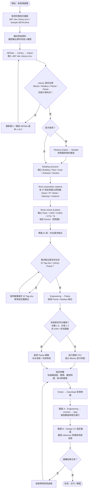
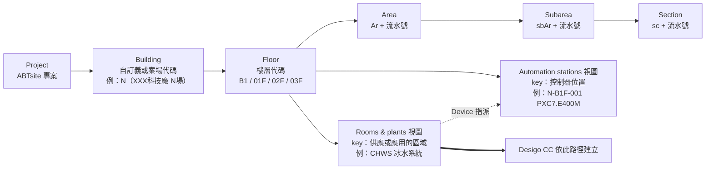
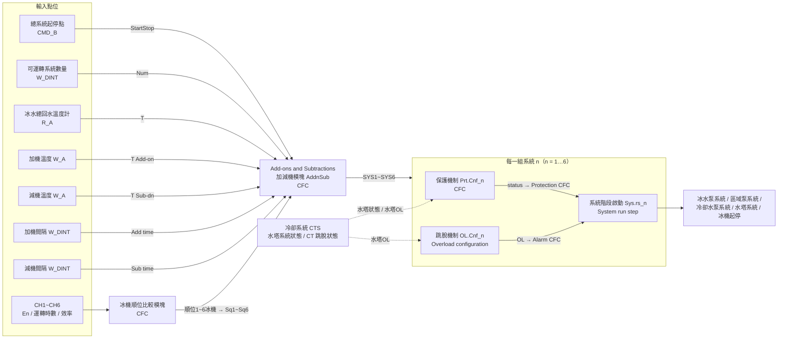
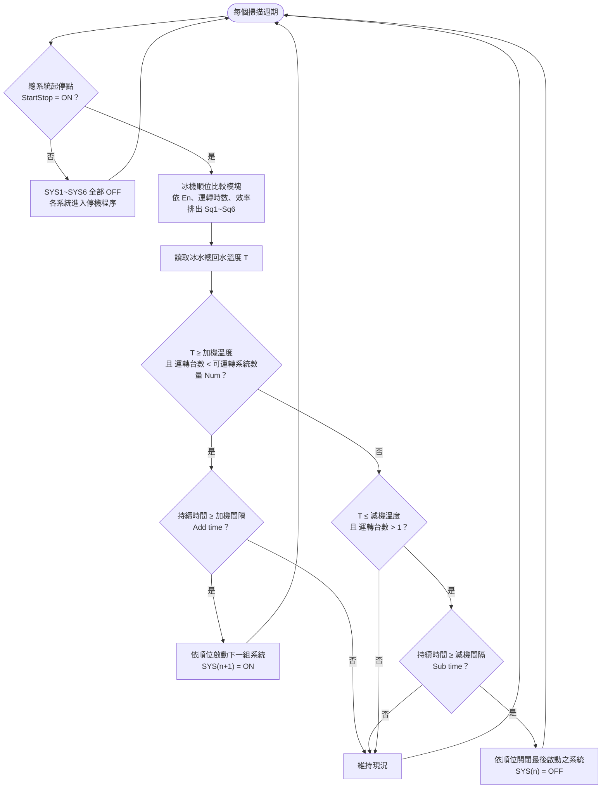
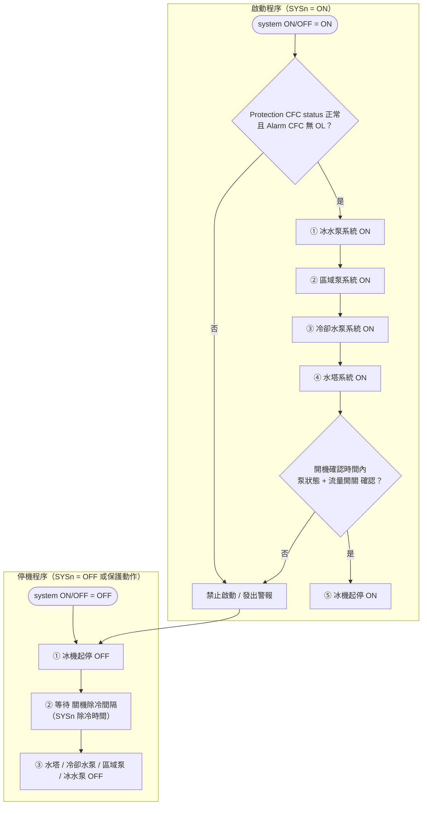
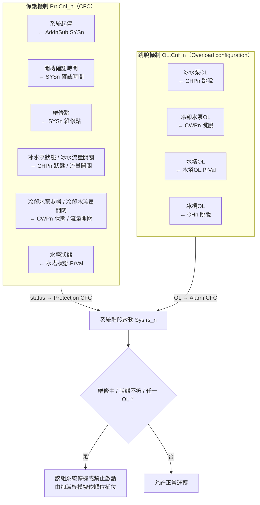
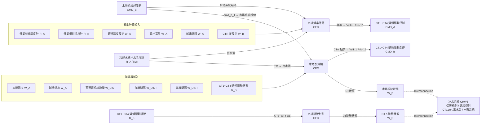
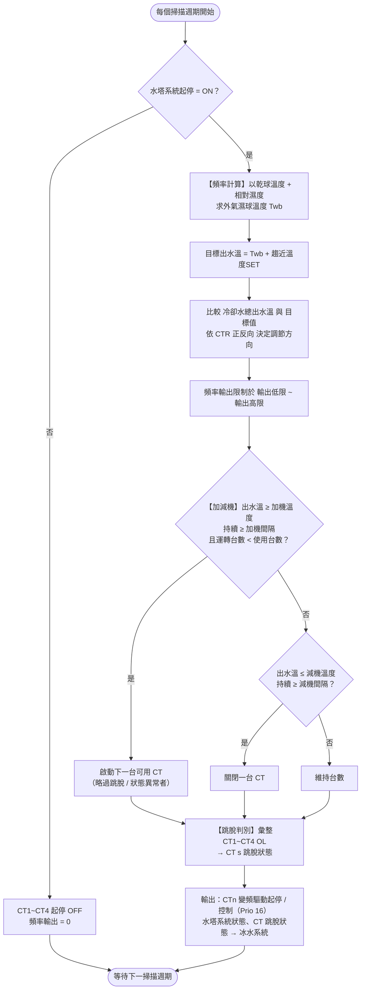
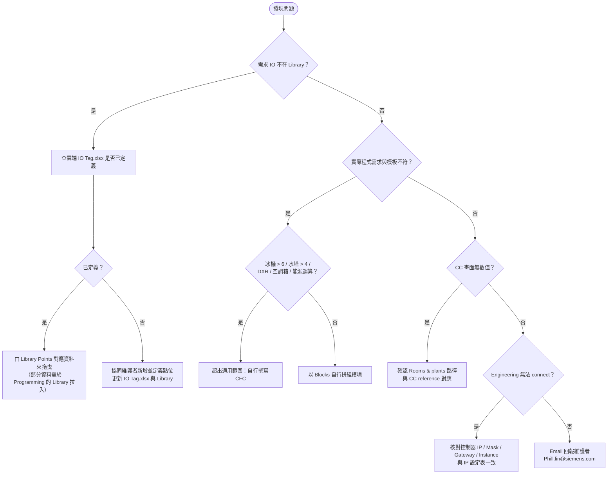

# 流程圖總覽

所有流程圖以 Mermaid 撰寫，原始碼位於 `flowcharts/*.mmd`，並輸出 SVG / PNG。GitHub 可直接渲染下方 Mermaid 區塊。

> 標示【推定】者為依 CFC 腳位名稱推論之邏輯，實際行為以 Library 模塊為準。

## 目錄

1. [新案場建置流程](#1-新案場建置流程)
2. [ABTsite 資料階層](#2-abtsite-資料階層)
3. [冰水系統 CFC 資料流](#3-冰水系統-cfc-資料流)
4. [冰水系統加減機邏輯【推定】](#4-冰水系統加減機邏輯推定)
5. [冰水系統階段啟動 / 停機程序【推定】](#5-冰水系統階段啟動--停機程序推定)
6. [保護機制與跳脫機制](#6-保護機制與跳脫機制)
7. [冷卻系統 CFC 資料流](#7-冷卻系統-cfc-資料流)
8. [冷卻系統頻率與加減機邏輯【推定】](#8-冷卻系統頻率與加減機邏輯推定)
9. [故障排除決策流程](#9-故障排除決策流程)

## 1. 新案場建置流程

圖檔：[SVG](../flowcharts/01-deployment-workflow.svg) ／ [PNG](../flowcharts/01-deployment-workflow.png)

## 2. ABTsite 資料階層

圖檔：[SVG](../flowcharts/02-data-hierarchy.svg) ／ [PNG](../flowcharts/02-data-hierarchy.png)

## 3. 冰水系統 CFC 資料流

圖檔：[SVG](../flowcharts/03-chws-dataflow.svg) ／ [PNG](../flowcharts/03-chws-dataflow.png)

## 4. 冰水系統加減機邏輯【推定】

圖檔：[SVG](../flowcharts/04-chws-staging.svg) ／ [PNG](../flowcharts/04-chws-staging.png)

## 5. 冰水系統階段啟動 / 停機程序【推定】

圖檔：[SVG](../flowcharts/05-chws-run-step.svg) ／ [PNG](../flowcharts/05-chws-run-step.png)

## 6. 保護機制與跳脫機制

圖檔：[SVG](../flowcharts/06-protection-trip.svg) ／ [PNG](../flowcharts/06-protection-trip.png)

## 7. 冷卻系統 CFC 資料流

圖檔：[SVG](../flowcharts/07-cts-dataflow.svg) ／ [PNG](../flowcharts/07-cts-dataflow.png)

## 8. 冷卻系統頻率與加減機邏輯【推定】

圖檔：[SVG](../flowcharts/08-cts-control.svg) ／ [PNG](../flowcharts/08-cts-control.png)

## 9. 故障排除決策流程

圖檔：[SVG](../flowcharts/09-troubleshooting.svg) ／ [PNG](../flowcharts/09-troubleshooting.png)

