# ABTsite Library 使用手冊

| 項目 | 內容 |
|---|---|
| 文件名稱 | ABTsite Library 使用手冊（Guide） |
| 對應版本 | ABT site Library v1.1.3 |
| 適用軟體 | Siemens ABTsite v5.2 以上 |
| 適用對象 | 系統工程師、外包建置人員 |
| 維護者 | Phill.Lin / SI B（Phill.lin@siemens.com） |
| 文件日期 | 2026-10-21 |
| 機密等級 | 西門子 SI B 內部使用，不得外流 |

---

## 目錄

1. [概述](#1-概述)
2. [名詞定義](#2-名詞定義)
3. [系統需求與準備](#3-系統需求與準備)
4. [安裝 Library](#4-安裝-library)
5. [以範例專案熟悉操作](#5-以範例專案熟悉操作)
6. [新案場建置流程](#6-新案場建置流程)
7. [冰水系統建置](#7-冰水系統建置)
8. [冷卻系統建置](#8-冷卻系統建置)
9. [下載與驗證](#9-下載與驗證)
10. [常見問題與故障排除](#10-常見問題與故障排除)
11. [限制與注意事項](#11-限制與注意事項)
12. [維護與版本管理](#12-維護與版本管理)
13. [附錄](#13-附錄)

---

## 1. 概述

### 1.1 目的

ABT site Library 是一套標準化設計及通用資料庫，提供：

1. 各類點位（AI、AO、AV、DI、DO）資料庫
2. 功能模塊（Blocks）資料庫
3. 冰水系統程式（CHSYS）
4. 冷卻系統程式（CTSYS）
5. 常用點位模板與 Modbus 通訊 mapping
6. 控制器建置路徑規則

用於非客製化案場快速建置，或作為外包提供資料之標準。

### 1.2 適用範圍

| 適用 | 不適用 |
|---|---|
| 冰機 ≤ 6 台之冰水系統 | DXR 系列控制器 |
| 冷卻水塔 ≤ 4 台之冷卻系統 | 空調箱系統 |
| Building structure layout 製作 | 能源運算 |
| 查找標準點位名稱 | 非常態 / 客製化控制邏輯 |
| 確認 Desigo CC 資料生成路徑 | |

### 1.3 文件架構

本手冊為總綱，細節請參照：

| 主題 | 文件 |
|---|---|
| 命名與建置規則 | [Building-Rules.md](Building-Rules.md) |
| 點位、模塊、Modbus 參考 | [Point-Tag-Reference.md](Point-Tag-Reference.md) |
| 冰水系統 CFC | [CFC-Chilled-Water-System.md](CFC-Chilled-Water-System.md) |
| 冷卻系統 CFC | [CFC-Cooling-Tower-System.md](CFC-Cooling-Tower-System.md) |
| 範例案場 | [Sample-Site.md](Sample-Site.md) |
| 流程圖 | [Flowcharts.md](Flowcharts.md) |
| 檢查表 | [Pre-Download-Checklist.md](Pre-Download-Checklist.md) |

---

## 2. 名詞定義

| 名詞 | 說明 |
|---|---|
| ABTsite | Siemens Automation Building Tool site，用於 Desigo PXC 控制器之工程建置 |
| Library | ABTsite 中存放可重複使用點位、模塊、Plant 模板之資料庫 |
| CFC | Continuous Function Chart，以功能方塊連線撰寫控制邏輯 |
| Plant | Rooms & plants 中的系統單位，例如 CHWS、CTS |
| Automation station | 控制器（PXC 等） |
| IO Tag | 標準點位代碼，定義於 IO Tag.xlsx |
| Units Name Tag | 設備 / 系統代碼，定義於 Units Name Tag.xlsx |
| IP 設定表 | 案場控制器名稱、IP、Mask、Gateway、Instance 之對照表 |
| Interconnection | CFC 跨頁 / 跨圖連接 |
| Prio | BACnet 命令優先權；本模板命令寫入 Prio 16 |
| CHWS / CWS | 冰水系統 |
| CTS | 冷卻水塔系統 |
| ZPS | 區域泵系統 |
| CHP / CWP / CH / CT | 冰水泵 / 冷卻水泵 / 冰機 / 冷卻水塔 |

---

## 3. 系統需求與準備

### 3.1 軟體環境

| 項目 | 要求 |
|---|---|
| 作業系統 | Windows、Linux |
| 工程軟體 | ABTsite v5.2 以上 |
| 監控端（驗證用） | Desigo CC |

### 3.2 必要檔案

| 檔案 | 用途 |
|---|---|
| `ABT site Library.s1cx` | Library 套件 |
| `Sample.ABTArchive` | 範例專案 |
| `Sample.pdf` | 範例情境說明 |
| IO Tag.xlsx | 標準點位代碼（雲端） |
| Units Name Tag.xlsx | 設備 / 系統代碼（雲端） |
| 案場 IP 設定表 | 控制器網路與命名 |
| 案場 IO 表 | 需求點位清單 |

### 3.3 使用前確認

- 已取得完整程式檔案。
- 電腦符合執行環境要求。
- 已確認可匯入的資料庫。
- 已確認輸出資料夾具有寫入權限。
- 若會修改、移動或覆蓋檔案，已先備份原始資料。

---

## 4. 安裝 Library

### 4.1 匯入

1. 開啟 ABTsite。
2. 進入 Library。
3. 執行 Import，選擇 `ABT site Library.s1cx`。

### 4.2 確認安裝成功

Library 中出現 `ABT site Library` 資料夾，內含四個子資料夾：

| 資料夾 | 內容 |
|---|---|
| Blocks | 冰機系統、前置條件、水塔系統、特殊條件 |
| Modbus device | BELIMO閥體、Chiller、Flow meter、LINE、Power Meter、Vertive、VFD |
| Plants | 冰水系統、冷卻系統模板 |
| Points | AI、AO、AV、DI、DO |

> 部分資料需在 Programming 的 Library 才可拉入使用。

---

## 5. 以範例專案熟悉操作

以下流程使用隨附範例資料，不修改正式資料。

1. 在 Projects 執行 Restore project，選擇 `Sample.ABTArchive`。
2. 開啟專案。
3. 以 Administrator 帳號登入（密碼由維護者另行提供）。
4. 對照 [Sample-Site.md](Sample-Site.md) 檢視：
   - Building structure 兩種檢視
   - 各控制器 Engineering → Plants 點位樹
   - N-B1F-001 冰水系統 CFC、N-03F-001 冷卻系統 CFC

---

## 6. 新案場建置流程

### 6.1 建立 Building structure

1. Building → Building structure。
2. 建立 Building：Name 為自訂義或案場代碼，Description 為樓宇名稱。
3. 建立 Floor：Name / Description 為樓層代碼（B1、01F、02F…）。
4. 視需要建立 Area（`Ar`+流水號）、Subarea（`sbAr`+流水號）、Section（`sc`+流水號）。
5. 視需要設定 Bacnet ranges、IP ranges（依 IP 設定表）。

### 6.2 建立控制器（Show automation stations）

於對應樓層新增控制器，依 IP 設定表填入：

| 欄位 | 來源 |
|---|---|
| Name | 控制器名稱，例 `N-B1F-001` |
| Description | `供應區域-XX系統` 或案場設備編號 |
| Equipment ID / Device instance number / Host name | instance |
| IP address / Subnet mask / Default gateway | IP / mask / gateway |

### 6.3 建立 Plant（Show rooms & plants）

1. 於「供應或應用的區域」所在樓層建立 Plant。
2. Plant Name 依規則：CWS(CHWS)、HWS、BS、CTS、`*S`（`*` 查 Units Name Tag）。
3. 同系統不同控制器以 extension 區分，例：`ZPS(N)`、`ZPS(S)`。
4. 指派 Device 為對應控制器。

> Desigo CC 依此路徑建立物件，命名確定後請勿任意變更，以免 CC reference 失效。

### 6.4 準備 IO 表並比對點位

1. 依設計圖整理 IO 表（設備、點位類型、功能）。
2. 逐筆比對 IO Tag.xlsx 與 Library Points（代碼表見 [Point-Tag-Reference.md](Point-Tag-Reference.md)）。
3. 找不到的點位：與維護者協同新增並定義，更新 IO Tag.xlsx 後再使用。

### 6.5 建立 Plant 點位樹

1. 開啟控制器 → Engineering → Plants。
2. 依「設備 → 側別（入水側 / 出水側 / 風側 / 水側）→ 驅動方式（直接 / 變頻）→ 點位」建立資料夾。
3. 由 Library Points 拖曳點位；Modbus 設備由 Modbus device 拖曳。
4. 點位名稱維持 `[類型] 中文功能` 格式。

### 6.6 套用系統模板

| 系統 | 條件 | 做法 |
|---|---|---|
| 冰水系統 | 冰機 ≤ 6 | 套用 Plants 冰水系統模板，見第 7 章 |
| 冷卻系統 | 水塔 ≤ 4 | 套用 Plants 冷卻系統模板，見第 8 章 |
| 不符模板 | 非常態系統 | 以 Blocks 自行拼組或自行撰寫 CFC |

---

## 7. 冰水系統建置

詳細接線表見 [CFC-Chilled-Water-System.md](CFC-Chilled-Water-System.md)。

### 7.1 模塊組成

| 層級 | 模塊 | 功能 |
|---|---|---|
| 系統層 | 總系統起停點（CMD_B） | 整體冰水系統起停命令 |
| 系統層 | 冰機順位比較模塊 | 依可用、運轉時數、效率排出啟動順位 |
| 系統層 | Add-ons and Subtractions（AddnSub） | 依冰水總回水溫度加減機，輸出 SYS1~SYS6 |
| 每組系統 | 保護機制（Prt.Cnf_n） | 檢查泵狀態、流量開關、水塔狀態、維修點 |
| 每組系統 | 跳脫機制（OL.Cnf_n） | 彙整冰水泵、冷卻水泵、水塔、冰機跳脫 |
| 每組系統 | 系統階段啟動（Sys.rs_n） | 分段起停冰水泵、區域泵、冷卻水泵、水塔、冰機 |

### 7.2 建置步驟

1. 確認冰機台數（≤ 6），決定系統組數 n。
2. 建立系統層點位：總系統起停點、可運轉系統數量、冰水總回水溫度計、加機 / 減機溫度、加機 / 減機間隔。
3. 於冰機順位比較模塊接入 CH1~CHn 的 En、運轉時數、效率。
4. 每組系統建立點位：SYSn 維修點、CHPn 狀態 / 流量開關 / 跳脫、CWPn 狀態 / 流量開關 / 跳脫、CHn 跳脫、SYSn 確認時間、SYSn 除冷時間。
5. 確認 AddnSub.SYSn 接至每組保護機制與系統階段啟動。
6. 將冷卻系統的水塔狀態、水塔 OL 接入每組保護 / 跳脫機制。
7. 系統階段啟動輸出接至實體起停點：冰水泵系統、區域泵系統、冷卻水泵系統、水塔系統、冰機起停。

### 7.3 控制邏輯摘要

加減機（依腳位推定）：

系統階段啟動（依腳位推定）：

保護與跳脫：

### 7.4 參數設定

所有參數範例預設值為 0，下載前必須設定。建議值見 [CFC-Chilled-Water-System.md 第 4 節](CFC-Chilled-Water-System.md#4-參數設定建議表)。

---

## 8. 冷卻系統建置

詳細接線表見 [CFC-Cooling-Tower-System.md](CFC-Cooling-Tower-System.md)。

### 8.1 模塊組成

| 模塊 | 功能 |
|---|---|
| 水塔頻率計算 | 依外氣乾球溫度、相對濕度、趨近溫度與出水溫計算風扇頻率 |
| 水塔加減機 | 依冷卻水出水溫決定運轉台數，輸出 CT1~CT4 起停與 CT 狀態 |
| 水塔跳脫判別 | 彙整 CT1~CT4 變頻驅動跳脫 |

### 8.2 建置步驟

1. 確認水塔台數（≤ 4）。
2. 建立點位：水塔系統起停點、外氣乾球溫度計、外氣相對濕度計、冷卻水總出水溫度計、趨近溫度設定、輸出高限 / 低限、CTR 正反向、加機 / 減機溫度、可運轉系統數量、加機 / 減機間隔。
3. 每台水塔建立：CTn 變頻驅動控制（CMD_A）、CTn 變頻驅動起停（CMD_B）、CTn 變頻驅動狀態（R_B）、CTn 變頻驅動跳脫（R_B）。
4. 確認頻率輸出與起停命令寫入 ValIn1、Prio 16。
5. 建立水塔系統狀態、CT s 跳脫狀態，並提供冰水系統使用（跨控制器時建立 reference）。

### 8.3 控制邏輯摘要

---

## 9. 下載與驗證

### 9.1 下載前

完成 [Pre-Download-Checklist.md](Pre-Download-Checklist.md)。

### 9.2 執行

1. Check 專案。
2. Download 至控制器進行終端運行。

執行期間注意：

| 項目 | 說明 |
|---|---|
| 進度顯示 | 不會顯示程式運轉週期 |
| 執行時間 | 跟隨控制器壽命年限（常駐執行） |
| 是否可中止 | 確認不影響現場系統後，可重啟或終止 |
| 禁止操作 | 調整 CFC 內部邏輯 |

### 9.3 驗證 A：ABTsite Engineering

1. 開啟 Engineering。
2. 確認 connect。
3. 點選 play。
4. 檢查數值與程式運行狀況（加減機輸出、保護狀態、頻率輸出）。

### 9.4 驗證 B：Desigo CC

1. 開啟 CC 指定畫面。
2. 確認 reference 已經對應。
3. 檢查對應數值與系統流程。

### 9.5 建議功能測試項目

| 項目 | 測試方法 | 預期結果 |
|---|---|---|
| 總系統起停 | 切換總系統起停點 | SYS 依順位啟動 / 全部停止 |
| 加機 | 將加機溫度暫調低於回水溫 | 經加機間隔後增加一組系統 |
| 減機 | 將減機溫度暫調高於回水溫 | 經減機間隔後減少一組系統 |
| 順位 | 調整 En 或運轉時數 | 順位輸出改變 |
| 保護機制 | 模擬流量開關未回饋 | 確認時間到後 status 異常、系統不啟動冰機 |
| 跳脫機制 | 模擬 CHP / CWP / CH / 水塔 OL | OL 輸出、系統停機或警報 |
| 維修點 | SYSn 維修點設 1 | 該組不參與運轉 |
| 水塔頻率 | 改變趨近溫度設定 | 頻率在高 / 低限內變化 |
| 水塔加減機 | 調整加 / 減機溫度 | CT 台數變化 |

> 測試完畢須將暫調參數恢復設計值。

---

## 10. 常見問題與故障排除

| 問題／錯誤訊息 | 可能原因 | 處理方式 |
|---|---|---|
| 需求 IO 不在 Library | 未建置 | 確認雲端 IO Tag.xlsx 是否有相關定義；若沒有，協同維護者新增並定義該點位 |
| 實際程式需求與模板不符 | 非常態系統 | 自行撰寫 CFC，或以 Blocks 模塊自行拼組（需一定熟悉度） |
| Library 無法拖曳某些資料 | 需由 Programming 的 Library 拉入 | 改從 Programming 的 Library 拖曳 |
| Desigo CC 無數值 | Plant 路徑或 reference 未對應 | 檢查 Rooms & plants 路徑與 CC reference |
| Engineering 無法 connect | 控制器網路設定錯誤 | 核對 IP / Mask / Gateway / Instance 與 IP 設定表 |
| 加減機不動作 | 參數為 0 或總系統起停未啟用 | 設定加減機溫度、間隔、可運轉系統數量 |
| 冰機不啟動 | 保護機制 status 異常 | 檢查泵狀態、流量開關、水塔狀態、維修點、確認時間 |
| 系統持續警報 | 跳脫機制 OL | 檢查各設備跳脫點位與現場設備 |
| 水塔頻率不變 | 起停未啟用或上下限設定相同 | 檢查水塔系統起停、輸出高限 / 低限 |
| 冰機 > 6 或水塔 > 4 | 超出模板上限 | 自行撰寫 CFC |

---

## 11. 限制與注意事項

- 數量上限：冰機 6 台、冷卻水塔 4 台。
- 尚未支援：空調箱系統、DXR 系列、能源運算。
- 禁止調整 CFC 內部邏輯；需修改時請與維護者確認並更新版本。
- 命令優先權固定使用 Prio 16；如現場有其他優先權需求，需另行評估。
- Plant 命名確定後勿任意變更，以免 Desigo CC reference 失效。
- 跨控制器資料（水塔狀態 / 水塔 OL）需確認 BACnet 通訊與 reference。
- 文件中【推定】之邏輯說明僅供理解，實際行為以 Library 模塊為準。

---

## 12. 維護與版本管理

| 項目 | 內容 |
|---|---|
| 維護者 | Phill.Lin / SI B |
| 聯絡方式 | Phill.lin@siemens.com |
| 問題回報 | Email（請附：案場、控制器、ABTsite 版本、Library 版本、截圖） |
| 維護狀態 | 持續維護 |

版本號規則建議（Semantic Versioning）：

| 位數 | 變更類型 | 範例 |
|---|---|---|
| 主版號 | 模塊介面（腳位）不相容變更 | v2.0.0 |
| 次版號 | 新增模塊 / 功能修復 | v1.1.0 |
| 修訂號 | 點位補充、文件修正 | v1.1.1 |

版本紀錄見 [CHANGELOG.md](../CHANGELOG.md)。

---

## 13. 附錄

### 13.1 外部資料庫

- [IO Tag.xlsx](https://1drv.ms/x/c/a26236f3247facec/IQD58ioHAmiNRp7MTH14Ym8bAVooEdthnYb2jcivli8UmnY?e=0imCkZ)
- [Units Name Tag.xlsx](https://1drv.ms/x/c/a26236f3247facec/IQBsOKZ_NfbbRaJ0zZoLh6pEAetL_lLOy7QPhdQO6UGG5Js?e=Bjwby0)

### 13.2 參考檔

- `docs/reference/CHSYS.pdf`：冰水系統 CFC 圖
- `docs/reference/CTSYS.pdf`：冷卻系統 CFC 圖
- `docs/reference/README_v1.1.3_original.pdf`：README 原稿

### 13.3 來源

- Notion：ABT Site 建置規則及範例（含 ABT Site Building structure、Controller Name Rule、Controller plant & room setting、範例）
