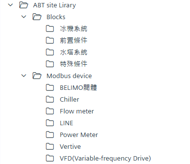
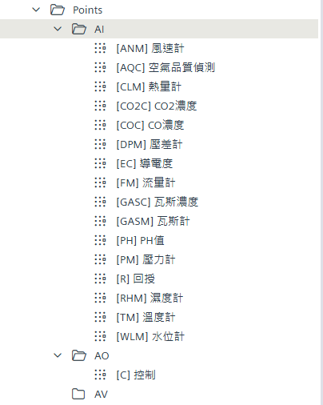
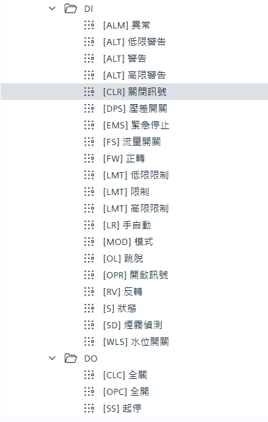

# Library 內容參考：Points、Blocks、Modbus

本文件列出 `ABT site Library` 匯入後的資料夾內容，作為拖曳點位與挑選模塊時的對照表。

---

## 1. Library 資料夾結構

```
ABT site Library/
├── Blocks/
│   ├── 冰機系統/
│   ├── 前置條件/
│   ├── 水塔系統/
│   └── 特殊條件/
├── Modbus device/
│   ├── BELIMO閥體/
│   ├── Chiller/
│   ├── Flow meter/
│   ├── LINE/
│   ├── Power Meter/
│   ├── Vertive/
│   └── VFD(Variable-frequency Drive)/
├── Plants/
│   ├── 冰水系統 (CHSYS)
│   └── 冷卻系統 (CTSYS)
└── Points/
    ├── AI/
    ├── AO/
    ├── AV/
    ├── DI/
    └── DO/
```



---

## 2. Points 點位代碼表

命名格式：`[代碼] 中文名稱`。代碼完整定義以雲端 IO Tag.xlsx 為準。

### 2.1 AI（類比輸入）

| 代碼 | 名稱 | 說明 |
|---|---|---|
| ANM | 風速計 | Anemometer |
| AQC | 空氣品質偵測 | Air quality |
| CLM | 熱量計 | Calorimeter / BTU meter |
| CO2C | CO2 濃度 | |
| COC | CO 濃度 | |
| DPM | 壓差計 | Differential pressure |
| EC | 導電度 | Electrical conductivity |
| FM | 流量計 | Flow meter |
| GASC | 瓦斯濃度 | |
| GASM | 瓦斯計 | |
| PH | PH 值 | |
| PM | 壓力計 | Pressure meter |
| R | 回授 | Feedback（閥位、頻率回授） |
| RHM | 濕度計 | Relative humidity |
| TM | 溫度計 | Temperature |
| WLM | 水位計 | Water level |

### 2.2 AO（類比輸出）

| 代碼 | 名稱 | 說明 |
|---|---|---|
| C | 控制 | 閥位 / 變頻器頻率控制 |

### 2.3 AV（類比數值）

目前資料夾為空，保留給設定值等虛擬點位（待補）。



### 2.4 DI（數位輸入，BACnet BI）

| 代碼 | 名稱 | 說明 |
|---|---|---|
| ALM | 異常 | 一般異常 |
| ALT | 低限警告 | 同代碼不同點位，以名稱區分 |
| ALT | 警告 | |
| ALT | 高限警告 | |
| CLR | 關閉訊號 | 閥 / 風門關到位 |
| DPS | 壓差開關 | |
| EMS | 緊急停止 | |
| FS | 流量開關 | Flow switch |
| FW | 正轉 | |
| LMT | 低限限制 | 同代碼不同點位 |
| LMT | 限制 | |
| LMT | 高限限制 | |
| LR | 手自動 | Local / Remote |
| MOD | 模式 | |
| OL | 跳脫 | Overload |
| OPR | 開啟訊號 | 閥 / 風門開到位 |
| RV | 反轉 | |
| S | 狀態 | 運轉狀態 |
| SD | 煙霧偵測 | Smoke detector |
| WLS | 水位開關 | |

### 2.5 DO（數位輸出，BACnet BO）

| 代碼 | 名稱 | 說明 |
|---|---|---|
| CLC | 全關 | |
| OPC | 全開 | |
| SS | 起停 | Start / Stop |



### 2.6 點位命名組合範例

| 設備 | 點位 | 組合 |
|---|---|---|
| 冰水泵 1 | 狀態 | `CHP1` + `[S] 狀態` |
| 冰水泵 1 | 跳脫 | `CHP1` + `[OL] 跳脫` |
| 冰水泵 1 | 流量開關 | `CHP1` + `[FS] 流量開關` |
| 冷卻水泵 1 | 狀態 | `CWP1` + `[S] 狀態` |
| 冰機 1 | 跳脫 | `CH1` + `[OL] 跳脫` |
| 冷卻水塔 1 | 變頻驅動起停 | `CT1` + `[SS] 起停` |
| 冷卻水塔 1 | 變頻驅動控制 | `CT1` + `[C] 控制` |
| 冰水總回水 | 溫度計 | `[TM] 溫度計` |

設備代碼（CHP、CWP、CH、CT、ZP 等）以 Units Name Tag.xlsx 為準。

---

## 3. Blocks 模塊分類

| 資料夾 | 內容 | 代表模塊（依 CFC 圖） |
|---|---|---|
| 冰機系統 | 冰水系統主要運算 | 冰機順位比較模塊、Add-ons and Subtractions（加減機）、保護機制、Overload configuration（跳脫機制）、System run step（系統階段啟動） |
| 水塔系統 | 冷卻系統主要運算 | 水塔頻率計算、水塔加減機、水塔跳脫判別 |
| 前置條件 | 啟動前允許條件 | 依 Library 內容 |
| 特殊條件 | 例外 / 特殊邏輯 | 依 Library 內容 |

模塊詳細接線見 [CFC-Chilled-Water-System.md](CFC-Chilled-Water-System.md) 與 [CFC-Cooling-Tower-System.md](CFC-Cooling-Tower-System.md)。

---

## 4. Modbus device

| 資料夾 | 設備類型 | 典型用途（一般用途參考，實際 mapping 以 Library 為準） |
|---|---|---|
| BELIMO閥體 | BELIMO 電動閥 / Energy Valve | 閥位控制與回授、流量 / 溫度讀取 |
| Chiller | 冰水主機 | 主機運轉資料、警報、設定值 |
| Flow meter | 流量計 | 瞬時 / 累積流量 |
| LINE | 通訊線路 / 閘道 | 依 Library 內容 |
| Power Meter | 電錶 | 電壓、電流、功率、電度 |
| Vertive | Vertive 機房空調 / UPS | 機房設備監控 |
| VFD | 變頻器 | 頻率、電流、運轉狀態、故障碼 |

---

## 5. CFC 資料型別速查

> 型別意義依 CFC 圖面命名歸納，正式定義以 ABTsite 說明為準。

| 型別 | 意義 | 常見用途 |
|---|---|---|
| CMD_B | 二元命令（含優先權陣列） | 系統起停點、設備起停 |
| CMD_A | 類比命令（含優先權陣列） | 變頻器頻率控制 |
| R_A | 類比讀值 | 溫度計、濕度計 |
| R_B | 二元讀值 | 狀態、跳脫、流量開關 |
| W_A | 類比寫入值 / 參數 | 加機溫度、減機溫度、趨近溫度、輸出上下限 |
| W_B | 二元寫入值 | 維修點、正反向、系統狀態 |
| W_DINT | 整數參數 | 可運轉系統數量、加減機間隔、確認時間、除冷時間 |

優先權：範例程式命令寫入 `PrioIn1 = 16`（Prio 16），未使用之輸入為 `17: Inactive`。
