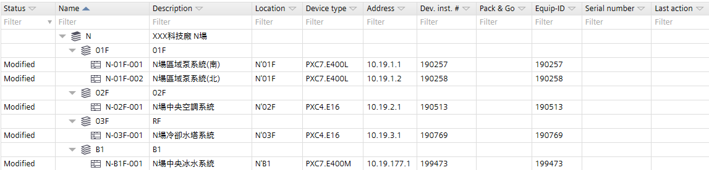
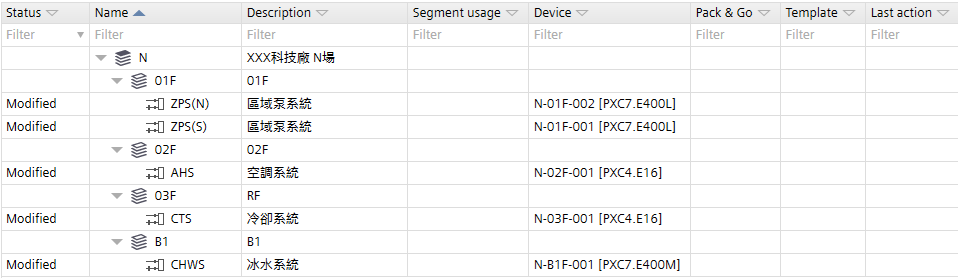
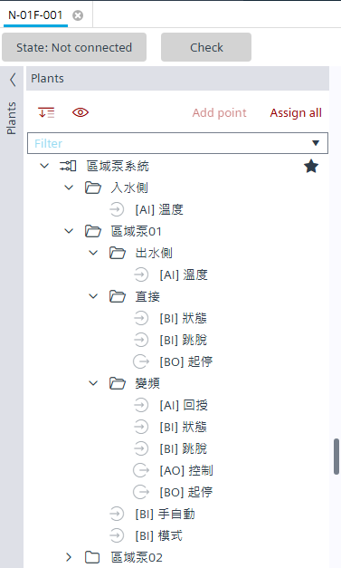
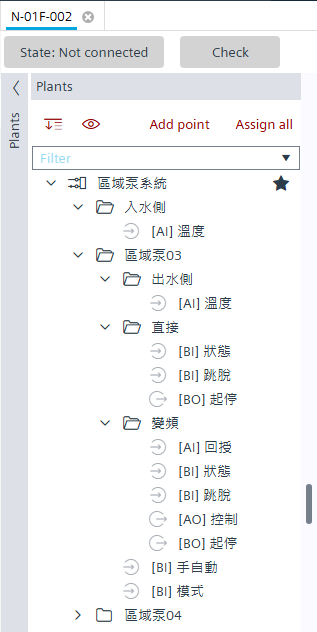
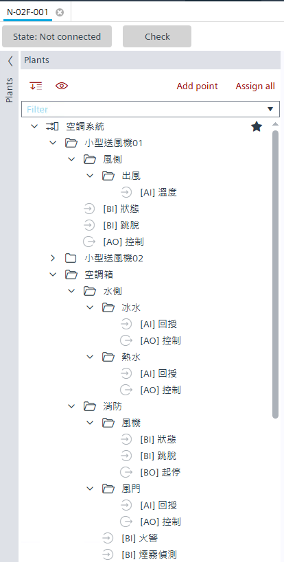
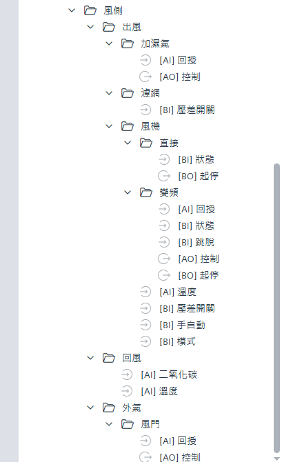

# 範例案場：XXX 科技廠 N 場

對應交付檔：`Sample.ABTArchive`、`Sample.pdf`。來源：Notion「ABT Site 建置規則及範例 → 範例」。

---

## 1. 情境

中央主機全域空間，共四層樓：B1 / 1F / 2F / 3F（RF）。

| 樓層 | 設備 | 控制器配置 |
|---|---|---|
| B1 | 主機、冰水泵、冷卻水泵 | 1 台 DDC |
| 1F | 區域泵兩區 | 2 台 DDC（各收一區） |
| 2F | AHU1、FCU × 2 | 1 台 DDC |
| 3F（RF） | 冷卻水塔 | 1 台 DDC |

---

## 2. 控制器設定（IP 設定表）

| Name | Description | 型號 | IP | Mask | Default gateway | Instance |
|---|---|---|---|---|---|---|
| N-B1F-001 | N場中央冰水系統 | PXC7.E400M | 10.19.177.1 | 255.255.0.0 | 10.19.0.254 | 199473 |
| N-01F-001 | N場區域泵系統(南) | PXC7.E400L | 10.19.1.1 | 255.255.0.0 | 10.19.0.254 | 190257 |
| N-01F-002 | N場區域泵系統(北) | PXC7.E400L | 10.19.1.2 | 255.255.0.0 | 10.19.0.254 | 190258 |
| N-02F-001 | N場中央空調系統 | PXC4.E16 | 10.19.2.1 | 255.255.0.0 | 10.19.0.254 | 190513 |
| N-03F-001 | N場冷卻水塔系統 | PXC4.E16 | 10.19.3.1 | 255.255.0.0 | 10.19.0.254 | 190769 |

Equipment ID 與 Dev. inst. # 相同，均採 IP 設定表 instance。

---

## 3. Show automation stations



```
N（XXX科技廠 N場）
├── 01F
│   ├── N-01F-001  N場區域泵系統(南)   N'01F  PXC7.E400L  10.19.1.1
│   └── N-01F-002  N場區域泵系統(北)   N'01F  PXC7.E400L  10.19.1.2
├── 02F
│   └── N-02F-001  N場中央空調系統     N'02F  PXC4.E16    10.19.2.1
├── 03F（RF）
│   └── N-03F-001  N場冷卻水塔系統     N'03F  PXC4.E16    10.19.3.1
└── B1
    └── N-B1F-001  N場中央冰水系統     N'B1   PXC7.E400M  10.19.177.1
```

## 4. Show rooms & plants



| 樓層 | Plant Name | Description | Device |
|---|---|---|---|
| 01F | ZPS(N) | 區域泵系統 | N-01F-002 [PXC7.E400L] |
| 01F | ZPS(S) | 區域泵系統 | N-01F-001 [PXC7.E400L] |
| 02F | AHS | 空調系統 | N-02F-001 [PXC4.E16] |
| 03F | CTS | 冷卻系統 | N-03F-001 [PXC4.E16] |
| B1 | CHWS | 冰水系統 | N-B1F-001 [PXC7.E400M] |

`ZPS(N)` / `ZPS(S)` 示範「同系統不同控制器以 extension 切分」規則。

---

## 5. Engineering setting（Plants 點位樹）

### 5.1 ZPS01 / ZPS02（區域泵系統）

| N-01F-001 | N-01F-002 |
|---|---|
|  |  |

N-01F-001 管理區域泵01、02；N-01F-002 管理區域泵03、04。每台泵含「出水側 / 直接 / 變頻」資料夾及手自動、模式點位。

### 5.2 AHU、FCU（空調系統）

| 小型送風機、空調箱水側 / 消防 | 空調箱風側 |
|---|---|
|  |  |

> AHS 僅作為建置規則示範；Library 目前不提供空調箱系統模板。

---

## 6. 練習步驟

1. Restore `Sample.ABTArchive` 並開啟。
2. 在 Building structure 切換兩種檢視，對照本文件第 3、4 節。
3. 開啟 N-B1F-001 → Engineering → Plants，對照 [CFC-Chilled-Water-System.md](CFC-Chilled-Water-System.md)。
4. 開啟 N-03F-001 → Engineering → Plants，對照 [CFC-Cooling-Tower-System.md](CFC-Cooling-Tower-System.md)。
5. 練習新增一個 Plant 與一組點位，確認命名符合 [Building-Rules.md](Building-Rules.md)。
